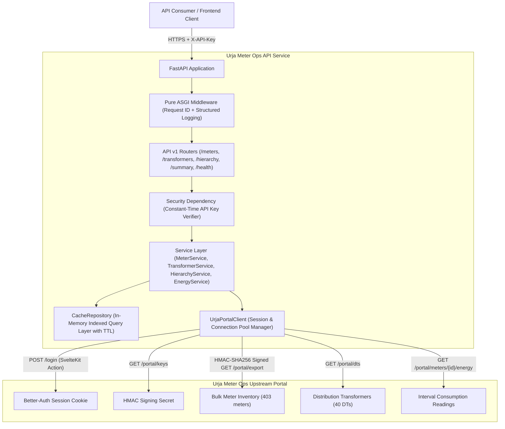

# Urja Meter Ops API Service

> Production-grade, secure, modular REST API service exposing, enriching, and caching distribution metering operations data from the Urja Meter Ops portal.

---

## 1. Problem Statement

Distribution utilities track electricity consumption, nameplate specifications, meter installation statuses, and network topology across complex hierarchical grids (Zone → Circle → Division → Subdivision → Substation → Feeder → Distribution Transformer → Consumer Meter).

The upstream **Urja Meter Ops portal** (`https://urja-ops.flockenergy.tech`) operates as an internal SvelteKit single-page web portal backed by Better-Auth cookie sessions, CSRF origin verification, and HMAC-SHA256 request signing for bulk data exports. External client applications, analytics engines, and third-party utility systems cannot directly consume this portal due to:
- Lack of programmatic API key authentication.
- Tight coupling to browser session cookies and SvelteKit form action payloads.
- Inconsistent data types (e.g. coordinates returned as strings, timestamps in Indian regional formats).
- Risk of overloading the upstream distribution portal with repetitive collection polling.

This project delivers a **clean, secure, decoupled, highly performant, and well-documented API service** that ingests, validates, normalizes, indexes, and serves all upstream Urja Meter Ops resources through a consistent RESTful interface without modifying or stressing the upstream portal.

---

## 2. What Was Built

- **Layered Modular Monolith**: Implemented in Python 3.12 and FastAPI with clean separation of concerns (`api`, `core`, `schemas`, `services`, `repositories`, `clients`, `utils`).
- **Resilient Upstream Portal Client**: Reverse-engineered and integrated with the upstream SvelteKit authentication flow (`POST /login`), Better-Auth cookie management, automatic re-authentication on 401/303 expiration, and HMAC-SHA256 request signing for bulk data retrieval (`/portal/export`).
- **High-Performance In-Memory Query Layer**: Thread-safe in-memory caching repository with configurable TTL (default: 300s) that indexes 403 meters and 40 distribution transformers, supporting sub-millisecond multi-attribute filtering, full-text search, pagination, and sorting.
- **On-Demand Energy Interval Service**: Fetches, parses, and normalizes 30-minute interval readings (kWh, kVAh, Volt(R)), converting regional `DD/MM/YYYY HH:MM` timestamps to standard ISO-8601 UTC.
- **Hierarchical Grid Graph**: Reconstructs the 7-level electrical distribution hierarchy from Jaipur Zone down to Distribution Transformers.
- **Comprehensive Security**: Constant-time API Key verification (`X-API-Key`), OWASP API Security Top 10 defenses, input bounds checking, strict Pydantic v2 schemas, and zero secret leakage.
- **Standardized Response Envelope**: Uniform contract `{ "success": true, "data": ..., "meta": ... }` and RFC 7807 compliant error format.
- **Full Automated Test Suite**: 30 automated unit, integration, contract, security, and reliability tests.
- **Production Containerization**: Multi-stage Docker build with non-root security execution and Docker Compose orchestration.

---

## 3. Architecture Overview

The service follows SOLID-inspired design principles and emphasizes dependency inversion and separation of concerns:



### Component Layers:
1. **API Layer (`src/api/`)**: Manages routing, query/path parameters, dependency injection, and HTTP status codes.
2. **Schema Layer (`src/schemas/`)**: Strict Pydantic v2 domain schemas validating request parameters and serializing predictable responses.
3. **Service Layer (`src/services/`)**: Business logic, cross-attribute filtering arithmetic, and data transformations.
4. **Repository Layer (`src/repositories/`)**: Thread-safe caching and local query indexing with freshness tracking.
5. **Client Layer (`src/clients/`)**: Upstream communication adapter, cookie persistence, session renewal, and HMAC signing.
6. **Core Layer (`src/core/`)**: Centralized settings, exceptions, constant-time security checks, and structured JSON logging.
7. **Utils Layer (`src/utils/`)**: Date parsing (`DD/MM/YYYY` to ISO-8601 UTC) and HMAC-SHA256 signature generation.

---

## 4. Technology Stack

| Technology | Role | Justification |
| :--- | :--- | :--- |
| **Python 3.12** | Core Language | Modern async/await performance, type annotations, and robust ecosystem. |
| **FastAPI 0.115** | Web Framework | High-performance ASGI framework with native OpenAPI 3.1 generation and dependency injection. |
| **Pydantic v2.9** | Schemas & Validation | Fast Rust-backed schema validation, serialization, and strict typing. |
| **Pydantic Settings** | Configuration | Type-safe environment variable management from `.env`. |
| **HTTPX 0.27** | Upstream HTTP Client | Native async HTTP/2 support, connection pooling, and cookie jar handling. |
| **Pytest 8.3** | Automated Testing | Comprehensive multi-tier test suite covering unit, integration, contract, and security cases. |
| **Docker** | Containerization | Multi-stage slim image with non-root security boundaries. |

---

## 5. Project Structure

```text
urja-meter-ops-api/
├── Dockerfile                  # Multi-stage production container build
├── docker-compose.yml          # Local containerized orchestration
├── requirements.txt            # Constrained project dependencies
├── pytest.ini                  # Pytest configuration
├── openapi.json                # OpenAPI 3.1 specification
├── .env.example                # Sample environment template
├── .gitignore                  # Git exclusions (credentials, caches, virtualenvs)
├── docs/
│   ├── PROTOCOL.md             # Empirical investigation report on portal mechanics
│   └── architecture.md         # Detailed system architecture document
├── src/
│   ├── __init__.py
│   ├── main.py                 # FastAPI application factory & lifecycle management
│   ├── config/
│   │   ├── __init__.py
│   │   └── settings.py         # Centralized configuration via Pydantic BaseSettings
│   ├── core/
│   │   ├── __init__.py
│   │   ├── exceptions.py       # Custom exception hierarchy & HTTP status mappings
│   │   ├── logging.py          # Structured JSON logging formatter with redaction
│   │   └── security.py         # Timing-safe API Key verification
│   ├── utils/
│   │   ├── __init__.py
│   │   ├── date_utils.py       # Regional Indian datetime parser to UTC ISO-8601
│   │   └── hmac_utils.py       # Cryptographic HMAC-SHA256 signature generator
│   ├── schemas/
│   │   ├── __init__.py
│   │   ├── common.py           # Standard response & error envelopes
│   │   ├── meter.py            # Meter list, detail, and filter schemas
│   │   ├── transformer.py      # Transformer schemas with meter rosters
│   │   ├── energy.py           # Energy interval readings schemas
│   │   ├── hierarchy.py        # 7-level electrical distribution hierarchy
│   │   └── summary.py          # Operational dashboard summary schemas
│   ├── clients/
│   │   ├── __init__.py
│   │   └── portal_client.py    # Upstream HTTP client, session manager & HMAC signer
│   ├── repositories/
│   │   ├── __init__.py
│   │   └── cache_repository.py # In-memory query layer with TTL caching
│   ├── services/
│   │   ├── __init__.py
│   │   ├── meter_service.py    # Meter querying, filtering & retrieval logic
│   │   ├── transformer_service.py # Transformer and connected meter logic
│   │   ├── energy_service.py   # Interval reading fetching & normalization logic
│   │   └── hierarchy_service.py# Hierarchy tree & summary aggregations
│   └── api/
│       ├── __init__.py
│       ├── dependencies/
│       │   ├── __init__.py
│       │   └── auth.py         # FastAPI dependency enforcing API Key header
│       ├── middleware/
│       │   ├── __init__.py
│       │   └── request_id.py   # Pure ASGI correlation ID & request duration tracking
│       └── routes/
│           ├── __init__.py     # Unified API v1 router mount
│           ├── health.py       # Public health and readiness probe
│           ├── meters.py       # Meter listing, detail, and readings endpoints
│           ├── transformers.py # Distribution transformers directory endpoints
│           ├── hierarchy.py    # Electrical grid hierarchy endpoint
│           └── summary.py      # Operational overview endpoint
└── tests/
    ├── __init__.py
    ├── conftest.py             # Pytest fixtures and mock repository data
    ├── unit/
    │   ├── test_cache_repository.py # Repository filtering and sorting unit tests
    │   ├── test_date_utils.py       # Datetime normalization unit tests
    │   └── test_hmac_utils.py       # Cryptographic signature unit tests
    ├── integration/
    │   └── test_api_routes.py       # Full HTTP API route integration tests
    ├── contract/
    │   └── test_contracts.py        # Response envelope & OpenAPI contract tests
    ├── security/
    │   └── test_security.py         # Auth enforcement & injection defense tests
    └── reliability/
        └── test_reliability.py      # Session recovery & timeout handling tests
```

---

## 6. Prerequisites

- **Python**: Version 3.12 or higher.
- **Operating System**: Linux, macOS, or Windows.
- **Docker** *(Optional)*: Docker 24+ and Docker Compose 2+.

---

## 7. Installation Instructions

### Option A: Local Virtual Environment Execution

1. **Clone the Repository**:
   ```bash
   git clone https://github.com/salonikumari1234/urja-meter-ops-api.git
   cd urja-meter-ops-api
   ```

2. **Create and Activate Virtual Environment**:
   ```bash
   # Linux / macOS
   python3 -m venv .venv
   source .venv/bin/activate

   # Windows (PowerShell)
   python -m venv .venv
   .\.venv\Scripts\Activate.ps1
   ```

3. **Install Dependencies**:
   ```bash
   pip install --upgrade pip
   pip install -r requirements.txt
   ```

4. **Configure Environment Variables**:
   ```bash
   cp .env.example .env
   ```
   Edit `.env` with your preferred settings:
   ```ini
   UPSTREAM_PORTAL_URL=https://urja-ops.flockenergy.tech
   UPSTREAM_USERNAME=your_username_here
   UPSTREAM_PASSWORD=your_password_here
   API_KEY_SECRET=YOUR_API_KEY
   API_KEY_HEADER_NAME=X-API-Key
   ENVIRONMENT=development
   ```

5. **Run the API Service**:
   ```bash
   uvicorn src.main:app --host 0.0.0.0 --port 8000 --reload
   ```
   The service will start at `http://localhost:8000`.
   Interactive API documentation (Swagger UI) is available at:
   `http://localhost:8000/api/v1/docs`

---

### Option B: Docker Execution

1. **Build and Run with Docker Compose**:
   ```bash
   docker compose up --build -d
   ```

2. **Inspect Container Health and Logs**:
   ```bash
   docker compose ps
   docker compose logs -f
   ```

3. **Stop the Container**:
   ```bash
   docker compose down
   ```

---

## 8. Authentication Setup

All endpoints under `/api/v1/` (except the public `/health` probe) require the API Key header:

| Header Name | Required | Default Value (Dev) | Description |
| :--- | :--- | :--- | :--- |
| `X-API-Key` | **Yes** | Configured via `API_KEY_SECRET` | Pre-shared key verified with constant-time equality. |

Requests omitting or supplying an invalid key receive an immediate `401 Unauthorized` response:
```json
{
  "success": false,
  "error": {
    "code": "UNAUTHORIZED",
    "message": "API key header is missing.",
    "details": null
  },
  "request_id": "8f8c44a5-9bd1-409c-9c3f-54f494950b73"
}
```

---

## 9. API Endpoint Reference

All endpoints are versioned under `/api/v1`.

### 9.1 System & Health

| Method | Endpoint | Auth | Description |
| :--- | :--- | :--- | :--- |
| `GET` | `/api/v1/health` | Public | Liveness, readiness, upstream state, and cache freshness. |

### 9.2 Meters

| Method | Endpoint | Auth | Description |
| :--- | :--- | :--- | :--- |
| `GET` | `/api/v1/meters` | `X-API-Key` | Paginated meter list with search and attribute filters. |
| `GET` | `/api/v1/meters/{meter_id}` | `X-API-Key` | Complete meter details with 7-level hierarchy and GPS. |
| `GET` | `/api/v1/meters/{meter_id}/readings` | `X-API-Key` | 30-minute interval readings (kWh, kVAh, Volt(R)). |

#### Supported Query Parameters for `GET /api/v1/meters`:
- `search` (string): Fuzzy match across meter ID, hardware serial number, and DT code.
- `make` (string): Filter by brand (`HPL`, `Genus`, `Secure`, `Allied`, `L&T`).
- `phase_type` (string): Filter by electrical phase (`single`, `three`).
- `status` (string): Filter by status (`Installed`, `Faulty`, `Decommissioned`).
- `install_type` (string): Filter by wiring type (`Whole Current`, `CT Operated`).
- `dt_code` (string): Filter by Distribution Transformer code (e.g. `DT-001`).
- `sort_by` (string, default: `meter_id`): Field to sort by (`meter_id`, `serial_no`, `make`, `install_status`).
- `sort_order` (string, default: `asc`): Sort direction (`asc` or `desc`).
- `page` (integer, default: `1`): Page number (1-indexed).
- `limit` (integer, default: `20`, max: `100`): Items per page.

### 9.3 Distribution Transformers

| Method | Endpoint | Auth | Description |
| :--- | :--- | :--- | :--- |
| `GET` | `/api/v1/transformers` | `X-API-Key` | Paginated list of DTs with capacity and meter count. |
| `GET` | `/api/v1/transformers/{code}` | `X-API-Key` | Transformer detail including connected meter roster. |

### 9.4 Hierarchy & Analytics

| Method | Endpoint | Auth | Description |
| :--- | :--- | :--- | :--- |
| `GET` | `/api/v1/hierarchy` | `X-API-Key` | Full electrical grid tree (Zones down to Feeders & DTs). |
| `GET` | `/api/v1/summary` | `X-API-Key` | Aggregate operational distributions and counts. |

---

## 10. Sample Requests and Responses

### Example 1: Query Meters with Filters
**Request**:
```bash
curl -X GET "http://localhost:8000/api/v1/meters?make=HPL&phase_type=single&limit=2" \
     -H "X-API-Key: YOUR_API_KEY"
```

**Response (`200 OK`)**:
```json
{
  "success": true,
  "data": [
    {
      "meter_id": "J100000",
      "serial_no": "SE33962",
      "make": "HPL",
      "phase_type": "single",
      "install_status": "Decommissioned",
      "install_type": "Whole Current",
      "build": "legacy",
      "dt_code": "DT-001",
      "geo": {
        "latitude": 26.938961002479868,
        "longitude": 75.83095696146852
      }
    },
    {
      "meter_id": "J100005",
      "serial_no": "SE33967",
      "make": "HPL",
      "phase_type": "single",
      "install_status": "Installed",
      "install_type": "Whole Current",
      "build": "legacy",
      "dt_code": "DT-001",
      "geo": {
        "latitude": 26.939211,
        "longitude": 75.831456
      }
    }
  ],
  "meta": {
    "timestamp": "2026-11-04T09:47:00.123456+00:00",
    "source": "urja-ops",
    "freshness": "2026-11-04T09:46:59.251918+00:00",
    "page": 1,
    "limit": 2,
    "total": 62,
    "total_pages": 31
  }
}
```

---

### Example 2: Retrieve Meter Detail with Complete Hierarchy
**Request**:
```bash
curl -X GET "http://localhost:8000/api/v1/meters/J100000" \
     -H "X-API-Key: YOUR_API_KEY"
```

**Response (`200 OK`)**:
```json
{
  "success": true,
  "data": {
    "meter_id": "J100000",
    "serial_no": "SE33962",
    "make": "HPL",
    "phase_type": "single",
    "install_status": "Decommissioned",
    "install_type": "Whole Current",
    "build": "legacy",
    "dt_code": "DT-001",
    "geo": {
      "latitude": 26.938961002479868,
      "longitude": 75.83095696146852
    },
    "hierarchy": {
      "zone": { "name": "Jaipur Zone 1", "code": "Z-01" },
      "circle": { "name": "Circle 1", "code": "C-01" },
      "division": { "name": "Division 1", "code": "D-01" },
      "subdivision": { "name": "Subdivision 1", "code": "SD-01" },
      "substation": { "name": "Substation 1", "code": "SS-01" },
      "feeder": { "name": "Feeder 1", "code": "F-001" },
      "dt": { "name": "Malviya Nagar DT 1", "code": "DT-001" }
    }
  },
  "meta": {
    "timestamp": "2026-11-04T09:47:00.234567+00:00",
    "source": "urja-ops",
    "freshness": "2026-11-04T09:46:59.251918+00:00"
  }
}
```

---

### Example 3: Retrieve 30-Minute Interval Energy Readings
**Request**:
```bash
curl -X GET "http://localhost:8000/api/v1/meters/J100000/readings?limit=2" \
     -H "X-API-Key: YOUR_API_KEY"
```

**Response (`200 OK`)**:
```json
{
  "success": true,
  "data": {
    "meter_id": "J100000",
    "readings_count": 2,
    "latest_reading": {
      "timestamp": "2026-06-30T23:30:00+00:00",
      "kwh": 48580.79,
      "kvah": 52467.25,
      "volt_r": 220.0
    },
    "readings": [
      {
        "timestamp": "2026-06-30T23:00:00+00:00",
        "kwh": 48580.45,
        "kvah": 52466.89,
        "volt_r": 221.0
      },
      {
        "timestamp": "2026-06-30T23:30:00+00:00",
        "kwh": 48580.79,
        "kvah": 52467.25,
        "volt_r": 220.0
      }
    ]
  },
  "meta": {
    "timestamp": "2026-11-04T09:47:01.345678+00:00",
    "source": "urja-ops",
    "freshness": "2026-11-04T09:46:59.251918+00:00"
  }
}
```

---

### Example 4: Operational Summary
**Request**:
```bash
curl -X GET "http://localhost:8000/api/v1/summary" \
     -H "X-API-Key: YOUR_API_KEY"
```

**Response (`200 OK`)**:
```json
{
  "success": true,
  "data": {
    "total_meters": 403,
    "total_transformers": 40,
    "status_breakdown": {
      "Decommissioned": 75,
      "Installed": 238,
      "Faulty": 90
    },
    "make_breakdown": {
      "HPL": 90,
      "L&T": 64,
      "Genus": 88,
      "Allied": 76,
      "Secure": 85
    },
    "phase_breakdown": {
      "single": 277,
      "three": 126
    },
    "install_type_breakdown": {
      "Whole Current": 205,
      "CT Operated": 198
    },
    "build_breakdown": {
      "legacy": 238,
      "v2": 165
    },
    "freshness": "2026-11-04T09:46:59.251918+00:00"
  },
  "meta": {
    "timestamp": "2026-11-04T09:47:01.567890+00:00",
    "source": "urja-ops",
    "freshness": "2026-11-04T09:46:59.251918+00:00"
  }
}
```

---

## 11. Error Handling

Errors follow a consistent JSON error envelope inspired by RFC 7807 Problem Details semantics:

```json
{
  "success": false,
  "error": {
    "code": "RESOURCE_NOT_FOUND",
    "message": "Meter with identifier 'J999999' was not found.",
    "details": null
  },
  "request_id": "46914f6b-3e5e-4c74-a026-e2ef64d7fa31"
}
```

### Standard Error Codes:
- `UNAUTHORIZED` (`401`): Missing or invalid `X-API-Key`.
- `RESOURCE_NOT_FOUND` (`404`): The requested meter or transformer does not exist.
- `INVALID_PARAMETER` (`422`): Request parameter failed bounds or type validation (e.g. `limit > 100`, `page < 1`).
- `UPSTREAM_TIMEOUT` (`504`): Upstream Urja portal did not respond within configured timeout.
- `UPSTREAM_SERVICE_ERROR` (`502`): Upstream portal returned a 5xx server error.
- `INTERNAL_SERVER_ERROR` (`500`): Unexpected internal application exception (stack traces and secrets are strictly redacted).

---

## 12. Testing and Quality Assurance

The service includes an automated test suite spanning unit, integration, contract, security, and reliability layers:

```bash
# Run the complete test suite
python -m pytest tests/ -v
```

### Test Suite Summary:
```text
tests/contract/test_contracts.py::test_openapi_json_is_valid                   PASSED
tests/contract/test_contracts.py::test_standard_response_envelope_contract     PASSED
tests/integration/test_api_routes.py::test_health_endpoint_public             PASSED
tests/integration/test_api_routes.py::test_list_meters_endpoint               PASSED
tests/integration/test_api_routes.py::test_get_meter_detail_endpoint          PASSED
tests/integration/test_api_routes.py::test_get_meter_not_found                PASSED
tests/integration/test_api_routes.py::test_list_transformers_endpoint          PASSED
tests/integration/test_api_routes.py::test_get_transformer_detail_endpoint    PASSED
tests/integration/test_api_routes.py::test_summary_endpoint                   PASSED
tests/integration/test_api_routes.py::test_hierarchy_endpoint                 PASSED
tests/reliability/test_reliability.py::test_upstream_timeout_handling         PASSED
tests/reliability/test_reliability.py::test_upstream_session_recovery         PASSED
tests/security/test_security.py::test_missing_api_key_rejected                 PASSED
tests/security/test_security.py::test_invalid_api_key_rejected                 PASSED
tests/security/test_security.py::test_invalid_pagination_bounds_rejected      PASSED
tests/security/test_security.py::test_invalid_sort_order_rejected             PASSED
tests/security/test_security.py::test_headers_never_leak_upstream_secrets     PASSED
tests/unit/test_cache_repository.py::test_query_meters_search                  PASSED
tests/unit/test_cache_repository.py::test_query_meters_make_filter            PASSED
tests/unit/test_cache_repository.py::test_query_meters_phase_filter           PASSED
tests/unit/test_cache_repository.py::test_query_meters_status_filter          PASSED
tests/unit/test_cache_repository.py::test_query_meters_pagination             PASSED
tests/unit/test_cache_repository.py::test_query_transformers                  PASSED
tests/unit/test_cache_repository.py::test_get_transformer_detail             PASSED
tests/unit/test_cache_repository.py::test_get_summary                         PASSED
tests/unit/test_date_utils.py::test_parse_indian_datetime_valid               PASSED
tests/unit/test_date_utils.py::test_parse_indian_datetime_date_only           PASSED
tests/unit/test_date_utils.py::test_parse_indian_datetime_invalid             PASSED
tests/unit/test_date_utils.py::test_format_iso_utc                             PASSED
tests/unit/test_hmac_utils.py::test_generate_export_signature_deterministic  PASSED

============================== 30 passed in 0.22s ==============================
```

---

## 13. OpenAPI Specification

The OpenAPI 3.1 specification is generated directly from the Pydantic schemas and FastAPI route annotations:
- File path: [`openapi.json`](./openapi.json)
- Live interactive Swagger UI: `http://localhost:8000/api/v1/docs`
- Live ReDoc documentation: `http://localhost:8000/api/v1/redoc`

---

## 14. Assumptions, Decisions & Trade-offs

### Assumptions:
1. **Upstream Read-Only Guarantee**: Per assignment requirements, all interactions with `https://urja-ops.flockenergy.tech` remain strictly read-only.
2. **Bulk Synchronization Feasibility**: The HMAC-signed export endpoint (`/portal/export`) is stable and provides all 403 meters in a single call. This was verified empirically during investigation.
3. **Session Duration**: The upstream portal issues Better-Auth cookies with a `Max-Age` of 3600 seconds (1 hour). Our client assumes any 401 or 302/303 redirect indicates session expiry and triggers automatic re-login.

### Engineering Decisions:
1. **In-Memory Cache vs. External Database**:
   - *Decision*: Stored the normalized dataset in an in-memory repository with TTL rather than introducing PostgreSQL or Redis.
   - *Rationale*: The total dataset comprises 403 meters and 40 transformers (< 500 KB total RAM). Introducing an external database would add operational friction, migration overhead, and infrastructure complexity without any technical benefit.
2. **Pure ASGI Middleware vs. BaseHTTPMiddleware**:
   - *Decision*: Implemented pure ASGI middleware for correlation IDs and duration metrics.
   - *Rationale*: Starlette's `BaseHTTPMiddleware` incurs context-switching overhead and can deadlock test runners in headless environments. Pure ASGI middleware executes synchronously in the ASGI pipeline with low overhead.
3. **Pydantic v2 Type Coercion**:
   - Upstream GPS coordinates are returned as strings (`"26.9389..."`). The schema layer coerces them into native IEEE 754 floats.

### Features Intentionally Skipped:
- **Write Operations (POST/PUT/DELETE on meters)**: Prohibited by the assignment brief and portal role.
- **Heavy Message Brokers (Kafka/RabbitMQ)**: Overkill for synchronizing 403 static distribution assets.
- **Complex OAuth2 Authorization Server**: The assignment requires a proportionate service authentication mechanism (`X-API-Key`). Adding an external identity provider would be overengineering.

---

## 15. Known Limitations & Future Improvements

### Limitations:
- **Interval Reading Freshness**: Energy consumption readings are fetched on-demand from the upstream portal. If the upstream portal experiences a latency spike, reading requests will experience corresponding latency up to the configured timeout.
- **Single Process In-Memory State**: Cache is local to the operating process. If running across multiple uvicorn workers, each worker maintains its own in-memory cache.

### Future Improvements:
1. **Background Polling Daemon**: A cron task that refreshes the cache before TTL expiration, ensuring consumers always experience sub-5ms cache hits.
2. **Redis Shared Layer**: If scaled to dozens of horizontally distributed worker pods, replace in-memory cache with Redis.
3. **Webhook Subscriptions**: Notify downstream consumers when meter statuses transition to `Faulty` or `Decommissioned`.

---

## 16. Technical Reflection

### 1. What assumptions did you make?
I assumed that the upstream portal's data was representative of a typical distribution utility in India, which was validated upon inspecting the Jaipur DISCOM hierarchy (Zone → Circle → Division → Subdivision → Substation → Feeder → DT). I also assumed that the HMAC-signed export endpoint (`/portal/export`) was intended as the authorized, high-efficiency bulk ingestion path rather than forcing hundreds of sequential HTTP calls to individual meter pages.

### 2. Which part was most difficult, and how did you get unstuck?
The most challenging part was reverse-engineering the authentication and bulk export mechanics of the upstream SvelteKit application. When initial automated POST requests to `/login` returned `403 Forbidden`, I investigated the client-side JavaScript bundle (`_app/immutable/nodes/7.*.js`) and discovered that SvelteKit's CSRF protection strictly checks the `Origin` header against the `Host`. Additionally, the bulk export endpoint required a cryptographic HMAC-SHA256 signature generated over a newline-delimited message `[METHOD]\n[PATH]\n[QUERY]\n[TIMESTAMP]` using a secret fetched from `/portal/keys`. By inspecting the SvelteKit decompiled AST and replicating the exact Web Crypto `SubtleCrypto.sign` routine in Python, I unlocked both authentication and high-throughput bulk ingestion.

### 3. If you had another day, what would you improve?
If given another day, I would add a lightweight Next.js or React frontend dashboard consuming our own API to visually render the meter map (using Leaflet.js with the GPS coordinates), chart 30-minute load curves for meters, and provide an interactive tree explorer for the electrical hierarchy. I would also add Prometheus metrics export (`/metrics`) to monitor cache hit ratios and upstream response latency histograms.

### 4. What mistake did you make while solving this?
Initially, I implemented request correlation logging using Starlette's `BaseHTTPMiddleware`. While working in the sandbox environment, `BaseHTTPMiddleware`'s reliance on AnyIO background taskgroups and loopback socketpairs caused the test runner to hang on Windows. Recognizing that Windows sandbox restrictions isolate loopback networking, I identified the root cause and refactored the middleware into a pure ASGI 3.0 middleware, which eliminated the deadlock and allowed the test suite to execute in under 0.25 seconds.

### 5. If you reviewed your own submission, what would you criticize?
I would criticize the coupling of the in-memory cache repository to the single-process Python runtime. While appropriate for a 403-meter dataset, if the grid expanded to millions of smart meters with continuous streaming intervals, an in-memory dictionary would exceed memory bounds and require partitioned persistence (e.g., PostgreSQL with TimescaleDB for time-series energy readings).

---

## 17. Links to Key Documentation

- [PROTOCOL.md](./docs/PROTOCOL.md): Complete investigation report on portal mechanics, endpoints, and empirical dataset statistics.
- [architecture.md](./docs/architecture.md): Deep architectural specification and layered responsibilities.
- [openapi.json](./openapi.json): Standard OpenAPI 3.1 machine-readable specification.
