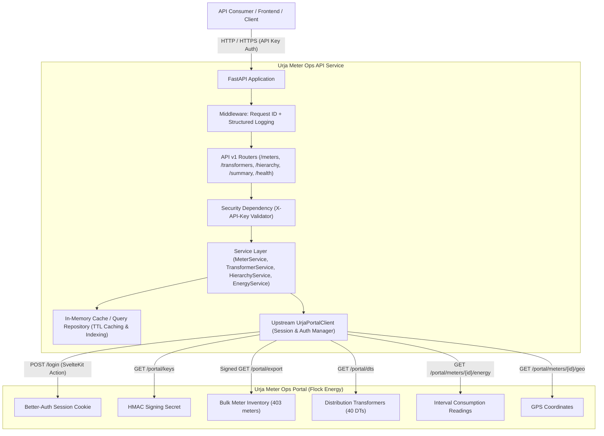

# Architecture and Design Document

## 1. Executive Summary

The **Urja Meter Ops API Service** is a clean, secure, modular, production-grade RESTful API service designed to expose and enrich distribution metering data from the upstream Urja Meter Ops portal (`https://urja-ops.flockenergy.tech`).

The service eliminates direct coupling between external consumers and the internal SvelteKit SPA endpoints of the upstream portal. It provides:
1. Strong schema validation and consistent RESTful contracts.
2. Robust upstream session lifecycle management with automated re-authentication.
3. Cryptographic HMAC-SHA256 request signing for upstream bulk export ingestion.
4. High-performance in-memory repository layer with configurable TTL caching to minimize upstream load and provide sub-5ms query times.
5. Standardized JSON response envelopes and RFC 7807-compliant error structures.
6. Comprehensive observability, structured request-correlation logging, and multi-tier testing.

---

## 2. Architecture Diagram

---

## 3. Layered Component Responsibilities

1. **API Layer (`src/api/`)**:
   - Manages HTTP request/response lifecycles, route definitions, path/query validation, and status codes.
   - Enforces dependency injection for authentication (`X-API-Key`) and service access.
   - Uses versioned routes prefix (`/api/v1`).

2. **Schema Layer (`src/schemas/`)**:
   - Implements Pydantic v2 domain models for strict request validation, response serialization, and OpenAPI 3.1 documentation.
   - Standardizes the uniform response envelope: `{ "success": bool, "data": ..., "meta": ..., "error": ... }`.

3. **Service Layer (`src/services/`)**:
   - Encapsulates all domain logic, cross-attribute filtering, pagination arithmetic, and hierarchical graph reconstruction.
   - Decoupled from upstream transport mechanics.

4. **Repository Layer (`src/repositories/`)**:
   - Manages local in-memory storage of normalized meters, transformers, and electrical hierarchies.
   - Supports thread-safe concurrent reads and atomic cache refreshes with freshness metadata.

5. **Client Layer (`src/clients/`)**:
   - `UrjaPortalClient`: Handles all outbound communication to `https://urja-ops.flockenergy.tech`.
   - Manages stateful SvelteKit / Better-Auth cookies, CSRF protection headers (`Origin`, `Referer`), automatic session expiration detection, and re-login.
   - Implements HMAC-SHA256 signature generation for `/portal/export`.
   - Enforces connection pooling, request timeouts, and exponential backoff retries.

6. **Core Layer (`src/core/`)**:
   - Centralized configuration management using `pydantic-settings`.
   - Centralized exception hierarchy and global FastAPI exception handlers.
   - Structured JSON logging with unique correlation `X-Request-ID` propagation.
